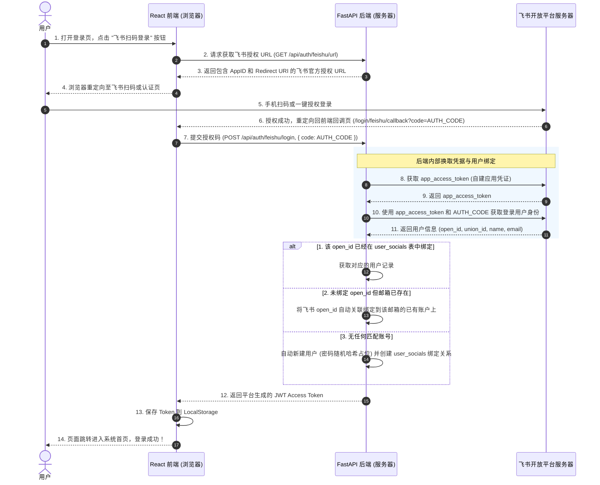

# AutoTestHub 系统部署与飞书集成技术总结报告

本报告系统性地整理了 `AutoTestHub` 平台的跨机器 Docker 自动化部署机制、今天的配置故障排查过程，以及最新实现的飞书扫码登录（免密认证）的架构与设计，供团队归档和后续维护使用。

---

## 一、 系统部署架构 (Docker & GitLab CI/CD)

针对“编译在 WSL、部署在 GitLab 服务器、测试在 Windows 浏览器”的真实开发环境，系统采用 **本地轻量编译 + 远程 SSH 滚动更新** 的跨机器部署方案。

### 1. 部署架构拓扑图

```mermaid
graph TD
    subgraph "1. 本地开发端 (Windows / WSL Ubuntu)"
        WSL[WSL Ubuntu Runner]
        Win[Win 浏览器 (测试端)]
    end

    subgraph "2. 代码与控制台 (GitLab)"
        GL_Repo[GitLab Repository]
        GL_Runner[GitLab CI/CD Runner 控制中心]
    end

    subgraph "3. 目标部署端 (GitLab 服务器)"
        GL_Server[GitLab 宿主机]
        Nginx_Cont[前端 Nginx 容器 (端口 15173)]
        API_Cont[后端 FastAPI 容器 (端口 8000)]
        SQLite_DB[(SQLite 数据库文件 /data)]
    end

    %% 流水线流程
    WSL -- 1.推送代码 --> GL_Repo
    GL_Repo -- 2.触发流水线 --> WSL
    WSL -- 3.执行编译 --> WSL
    WSL -- 4.前端打包产物 dist --> GL_Repo
    GL_Repo -- 5.推送制品与源码 --> GL_Server
    
    %% 服务器内部结构
    GL_Server -- 6.执行 rsync 与 docker-compose --> Nginx_Cont
    Nginx_Cont -- 反向代理 /api --> API_Cont
    API_Cont -- 读写 --> SQLite_DB
    
    %% 测试流程
    Win -- 7.访问 http://IP:15173 --> Nginx_Cont
```

### 2. 部署关键优化与故障解决排查

在本次部署落地过程中，共解决了以下 4 个关键痛点：

#### 痛点 1：前端 API 请求路径硬编码导致跨域及 Connection Refused
* **原逻辑**：前端 Axios 里的 `baseURL` 写死为 `http://localhost:8000/api`。当部署到远程服务器后，用户浏览器会请求自己本机的 `localhost`，导致所有请求失效。
* **优化后**：
  - 前端 `baseURL` 改为动态读取相对路径 `import.meta.env.VITE_API_BASE_URL || '/api'`。
  - 通过 Nginx 在服务器上同域托管，前端直接向 `/api` 发送请求，经 Nginx 透明反向代理至后端 `FastAPI:8000` 端口。这不仅解决了跨域（CORS）限制，也无需向外暴露后端 `8000` 端口。

#### 痛点 2：避免远程服务器编译导致系统开销过大
* **原逻辑**：前端 Dockerfile 使用多阶段构建并在远程重新下载依赖执行 `npm run build`。GitLab 服务器内存常年处于高占用状态，远程构建会耗尽系统 CPU 导致 GitLab 卡顿。
* **优化后**：
  - 简化远程 Dockerfile，删除所有 `node` 构建阶段，使其仅作为一个极简的 `nginx:alpine` 运行镜像。
  - 编译工作 100% 留在 WSL Runner 上进行，编译出的 `dist` 制品通过 GitLab CI 传递，并在部署阶段使用 `rsync` 安全传输至远程。远程 Docker 编译直接拷贝 `dist` 目录，**镜像构建只需 1 秒钟**，完全不消耗服务器算力。

#### 痛点 3：GitLab CI/CD 密钥格式兼容性
* **原逻辑**：`.gitlab-ci.yml` 中使用 `echo "$SSH_PRIVATE_KEY" | ssh-add -` 来导入 SSH 私钥。在部分 GitLab Runner 环境中，会因换行符处理不当或没有回车报 `Error loading key "(stdin)": error in libcrypto` 错误。
* **优化后**：
  - 在 `.gitlab-ci.yml` 的 `before_script` 中添加了判断分支。自动兼容了 GitLab 变量类型中 **"File" 形式**（行业最稳健实践）与普通 **"Variable" 形式** 的私钥注册，消除了由于控制台管道输入导致私钥解析损坏的问题。

#### 痛点 4：TypeScript 环境变量编译报错
* **原逻辑**：由于缺少 Vite 变量类型定义，Vite 编译在执行 `tsc` 时报 `Property 'env' does not exist on type 'ImportMeta'` 错误，导致 CI/CD 中断。
* **优化后**：
  - 前端新增 `src/vite-env.d.ts` 引入 `vite/client` 类型声明。
  - 在 `tsconfig.json` 的 `compilerOptions.types` 注册 `vite/client`，双保险解决了 TS 类型识别障碍。

---

## 二、 飞书扫码免密登录集成设计 (Authentication)

为确保 AutoTestHub 平台能够平滑接入您在飞书配置好的专属自建应用 **`cli_aabc16e6d778dcd9`**，我们采用了免密 OAuth 认证方案。

### 1. 授权与认证时序图



### 2. 数据库设计：新社交账户关联表 `user_socials`

我们设计了非破坏性的社交账号绑定表，在 `domain.py` 中定义，不影响 `users` 原有的结构，升级时 SQLite 会自动完成建表：

```sql
CREATE TABLE "user_socials" (
    "id" TEXT PRIMARY KEY,
    "user_id" TEXT,                    -- 关联 users.id
    "provider" TEXT DEFAULT 'feishu',  -- 社交渠道 (此处固定为 feishu)
    "uid" TEXT UNIQUE INDEX,           -- 飞书的 open_id (唯一识别符)
    "union_id" TEXT,                   -- 飞书的 union_id (企业内唯一识别符)
    "extra_data" TEXT,                 -- JSON 格式，保留飞书返回的用户信息快照
    "created_at" DATETIME DEFAULT CURRENT_TIMESTAMP,
    FOREIGN KEY("user_id") REFERENCES "users"("id") ON DELETE CASCADE
);
```

---

## 三、 飞书自建应用配置步骤与说明

在部署上线后，为了让前后台能与您的飞书自建应用 `cli_aabc16e6d778dcd9` 进行配合，您只需检查飞书开放平台的以下配置：

### 1. 安全设置与重定向校验 (最重要)
* 登录 [飞书开放平台](https://open.feishu.cn/) -> 进入您的应用 `cli_aabc16e6d778dcd9`。
* 进入 **开发配置 -> 安全设置**。
* 在 **重定向 URL (Redirect URI)** 中添加以下地址：
  ```text
  http://<您的GitLab服务器IP>:15173/login/feishu/callback
  ```
  *(注：如果本地开发测试，也需要添加 `http://localhost:15173/login/feishu/callback`)*

### 2. 开启网页应用
* 在 **应用功能 -> 网页应用** 中，开启网页应用功能。

### 3. 开通接口权限
* 进入 **开发配置 -> 权限管理**，在搜索框中搜索并申请开通以下两个敏感度较低的基础权限：
  - **获取用户基本信息** (`contact:user.base:readonly`)
  - **获取用户邮箱** (`contact:user.email:readonly`)（可选，用于和平台已有用户按邮箱匹配进行自动绑定）

### 4. 平台集成参数配置
您可以直接修改 GitLab 服务器上的 `.env` 文件，或者向 SQLite 的 `config` 表中插入以下三条配置记录（在“集成配置”或数据库直接编辑皆可）：
* `feishu_app_id` = `cli_aabc16e6d778dcd9`
* `feishu_app_secret` = `LXijs4cG6C2tE78RqVBmfgalyNAoxiwb`
* `feishu_redirect_uri` = `http://<您的GitLab服务器IP>:15173/login/feishu/callback`
